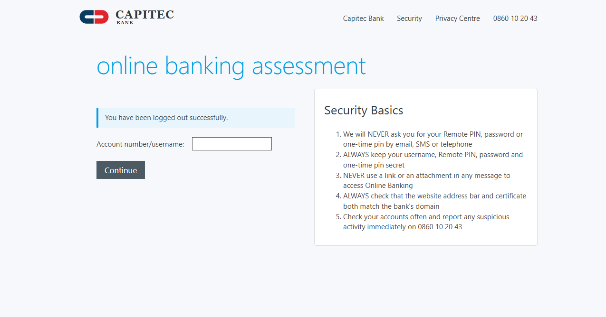
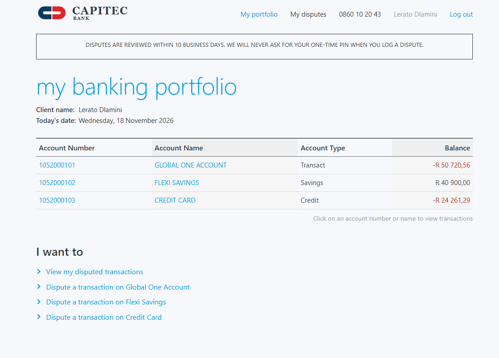
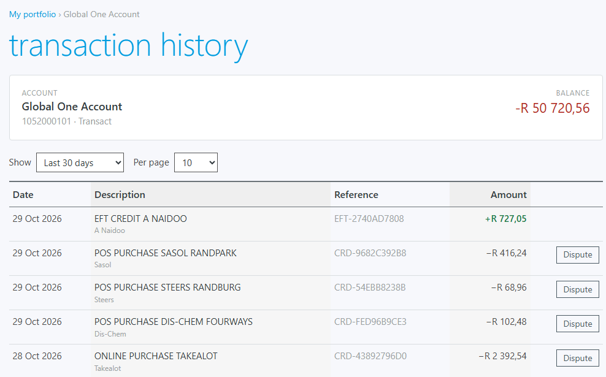
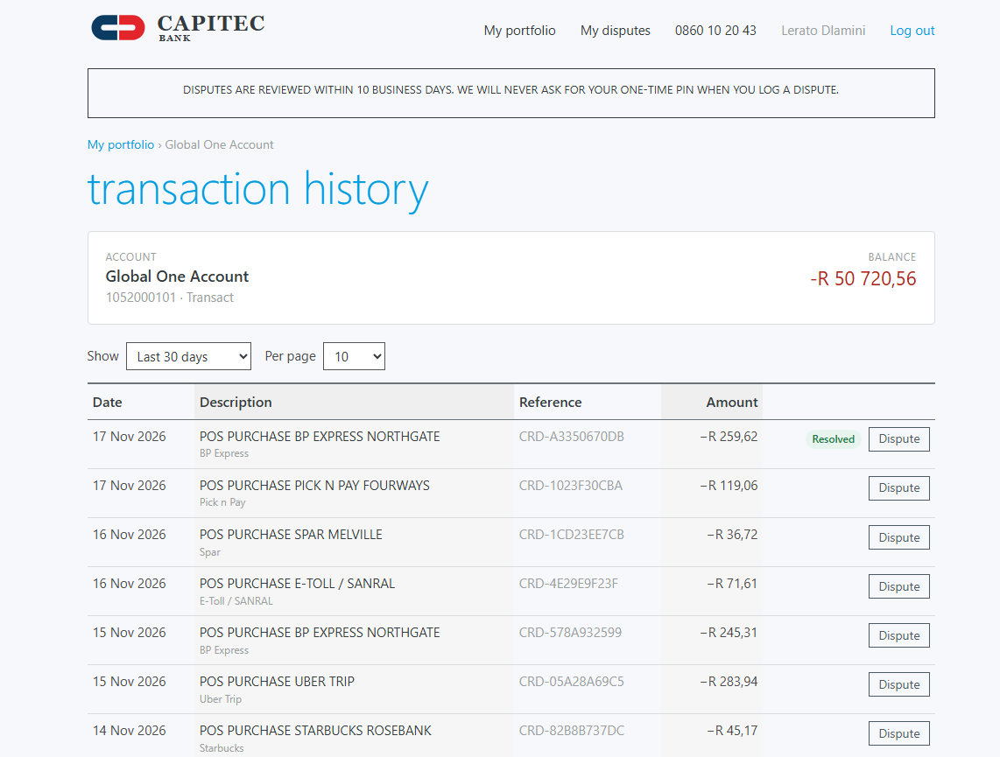
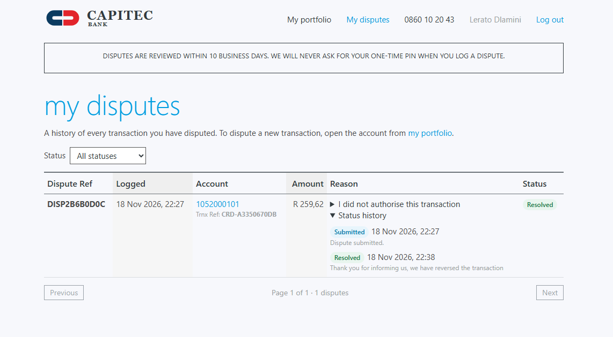
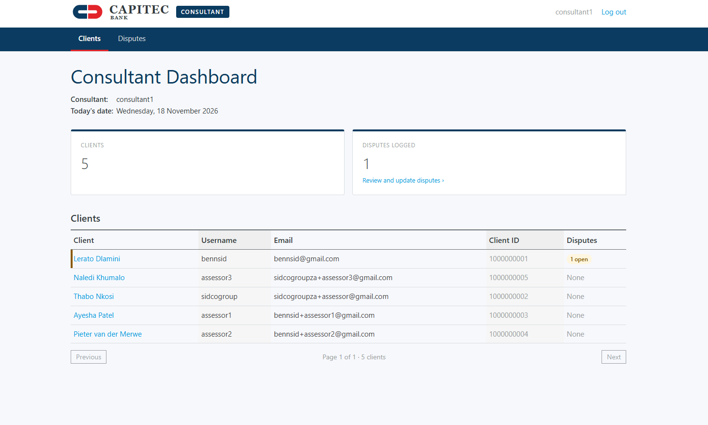
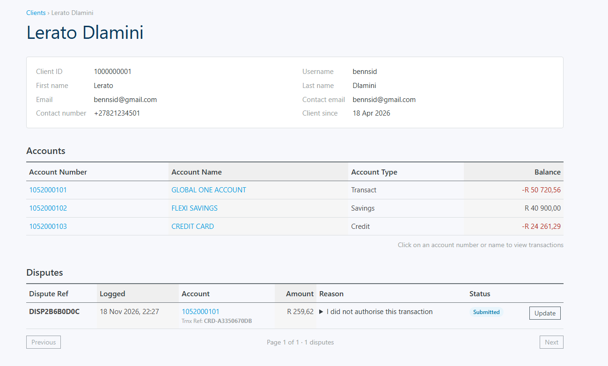
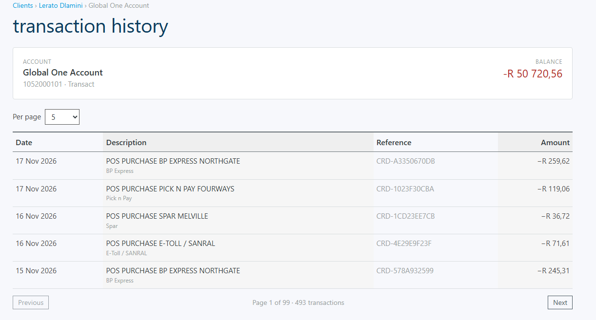
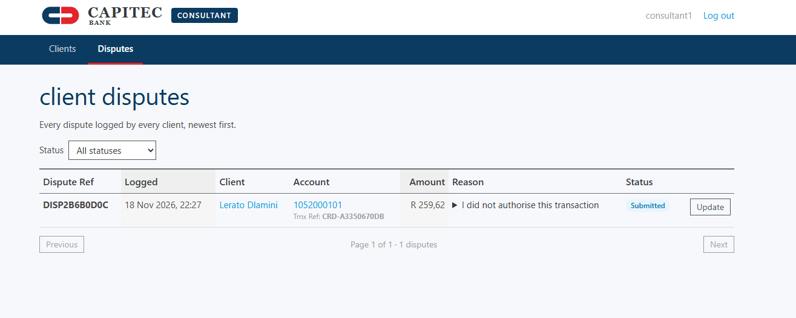
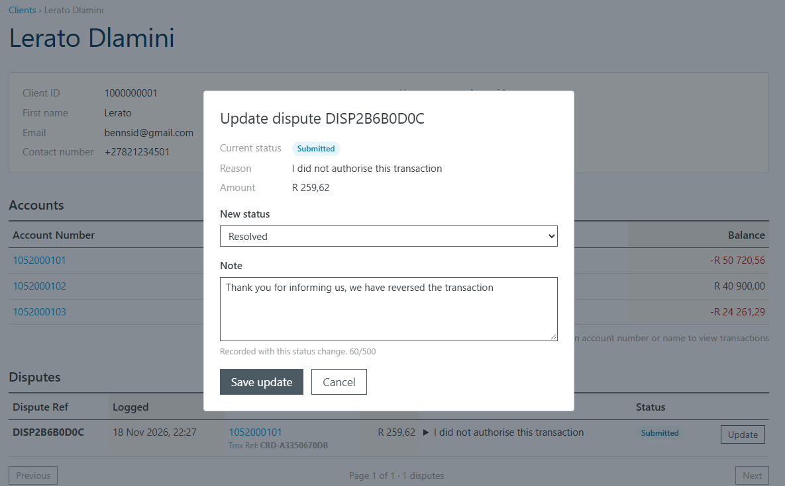

# Capitec Transactions Dispute Portal

[](https://github.com/sidcogroup/capitecassessmentweb/deployments/Production)
[](https://github.com/sidcogroup/capitecassessmentweb/actions/workflows/ci.yml)

A web application that lets bank customers **view their transactions and dispute them**, and lets bank consultants **review and resolve those disputes**. A historic view of every disputed transaction, with its full status timeline, is available to both sides.

**Live version:** <https://capitecassessmentweb.pages.dev>

---

## 1. Project description

This project is the solution to the following assessment brief:

> **2. Transactions Dispute Portal**
>
> Create a system (front end and back end) for customers to view transactions and dispute them. There must be a historic view of disputed transactions.

The solution is delivered as two parts:

| Part | Repository / location | Notes |
| --- | --- | --- |
| **Front end** | This repository | React single-page application, hosted on Cloudflare Pages |
| **Back end** | Separate .NET API | Runs on Azure Container Apps (South Africa North) |

Both **clients** and **consultants** use the same application and the same login screen; what they see afterwards depends on who they are.

## 2. Technology

| Layer | Technology |
| --- | --- |
| Front end | React 19, TypeScript, Vite, React Router, TanStack Query, React Hook Form + Zod |
| Testing / linting | Vitest, Testing Library, oxlint |
| Back end | .NET Web API running on **Azure Container Apps** |
| Hosting (front end) | **Cloudflare Pages** (+ a Pages Function that proxies `/api/*` to the back end) |
| CI/CD | GitHub Actions |

## 3. What the project contains

### 3.1 Login

One login screen caters for both user types:

- **Client** – signs in with their **account number / username**.
- **Consultant** – signs in with their **consultant username**.
- A **one-time PIN (OTP)** is sent to the user's **registered email address**, and must be entered to complete authentication.
- Sessions use an httpOnly cookie and expire after a period of inactivity.



### 3.2 Client dashboard

**Portfolio** – the client sees all of their accounts and balances, with quick links to view disputed transactions or start a dispute on any account.



**Account / transaction history** – every transaction on the selected account, filterable by period and paged. Each transaction has a **Dispute** button. Transactions that already have a dispute show its status (e.g. *Resolved*).




**My disputes** – the historic view. Clients can track every dispute they have raised, filter by status, and expand the reason and **status history** (Submitted → Resolved) including the note left by the consultant.



### 3.3 Consultant dashboard

- See the **list of all clients**, with an indicator showing which clients have **open disputes**.
- Open a client to view their **entire profile** – personal details, accounts, balances and every dispute they have raised.
- View **all disputes across the whole client base**, newest first, filterable by status.
- Select a dispute and **update its status**, adding a **note to the client** explaining whether and how it has been addressed. The note appears in the client's status history.







## 4. Architecture

```
Browser ──► Cloudflare Pages (React SPA)
               │
               └─ /api/*  ──► Pages Function (functions/api/[[path]].ts)
                                   │  same-origin proxy, keeps the session cookie
                                   ▼
                        .NET API on Azure Container Apps
```

The Pages Function proxies `/api/*` so the httpOnly session cookie issued by the back end works on the Pages domain. The target is configurable through `API_PROXY_TARGET` (see [wrangler.toml](wrangler.toml)).

## 5. Deployment

Deployment is automated with **GitHub Actions** and published to **Cloudflare Pages**.

| Workflow | Trigger | What it does |
| --- | --- | --- |
| [ci.yml](.github/workflows/ci.yml) | Pull requests to `main`; pushes to any other branch | `npm ci` → lint → test → build |
| [deploy-cloudflare.yml](.github/workflows/deploy-cloudflare.yml) | Push to `main`, or manual run | lint → test → build → `wrangler pages deploy` to Cloudflare Pages |

For the purpose of this assessment **no custom domain** has been configured. The default Cloudflare-provided address is used to reach the live version:

**<https://capitecassessmentweb.pages.dev>**

Required GitHub secrets for deployment: `CLOUDFLARE_API_TOKEN`, `CLOUDFLARE_ACCOUNT_ID`. Optional repository variable: `VITE_DISPUTES_API` (defaults to `live` in production).

## 6. Running locally

Requirements: Node.js 22+.

```bash
npm ci
cp .env.example .env     # then adjust as needed
npm run dev
```

| Script | Purpose |
| --- | --- |
| `npm run dev` | Start the Vite dev server (proxies `/api` to the back end) |
| `npm run build` | Type-check and build for production |
| `npm run lint` | Lint with oxlint |
| `npm test` | Run the Vitest suite once |
| `npm run test:watch` | Run tests in watch mode |
| `npm run preview` | Preview the production build |

### Environment variables

| Variable | Description |
| --- | --- |
| `VITE_API_PROXY_TARGET` | Back end the Vite dev server proxies `/api` to (default `https://localhost:7082`) |
| `VITE_DISPUTES_API` | `mock` (in-browser store, default for local dev) or `live` (calls `/api/v1/transactions/dispute`) |

### Running with Docker

The app can be packaged as a container image (multi-stage build: Node 22 builds the SPA, nginx serves it and proxies `/api/*` to the back end, mirroring the Cloudflare Pages Function). Requirements: Docker.

```bash
# 1. Build the image (from the repository root)
docker build -t capitec-dispute-portal .

# 2. Run it, then open http://localhost:8080
docker run --rm -p 8080:80 capitec-dispute-portal
```

Options:

| Option | Purpose |
| --- | --- |
| `-e API_PROXY_TARGET=<url>` | Back end that `/api/*` is proxied to at runtime (default: the hosted Azure API). For a back end on your machine use e.g. `http://host.docker.internal:5000`; a self-signed HTTPS dev certificate is rejected by nginx, so expose the API over HTTP or a trusted certificate. |
| `--build-arg VITE_DISPUTES_API=mock` | Build-time switch: `live` (default, calls the API) or `mock` (in-browser store, no back end needed). |

Example, with the in-browser mock disputes store:

```bash
docker build --build-arg VITE_DISPUTES_API=mock -t capitec-dispute-portal:mock .
docker run --rm -p 8080:80 capitec-dispute-portal:mock
```

Files: [Dockerfile](Dockerfile), [nginx.conf.template](nginx.conf.template), [.dockerignore](.dockerignore).

## 7. Project structure

```
functions/api/[[path]].ts   Cloudflare Pages Function – API proxy
src/api/                    API clients and TanStack Query hooks
src/auth/                   Auth context, route guard, idle timeout
src/components/             Shared UI (layouts, header, money, status badge…)
src/pages/                  Login, OTP, portfolio, account, dispute, my disputes
src/lib/                    Formatting, dispute status helpers, query client
.github/workflows/          CI and Cloudflare deployment pipelines
docs/screenshots/           Screenshots used in this README
```

## 8. Security notes

- Credentials are never requested by email, SMS or telephone; the UI repeats this guidance to users.
- OTP-based second factor for both clients and consultants.
- httpOnly session cookie, same-origin API proxy, automatic idle sign-out.
